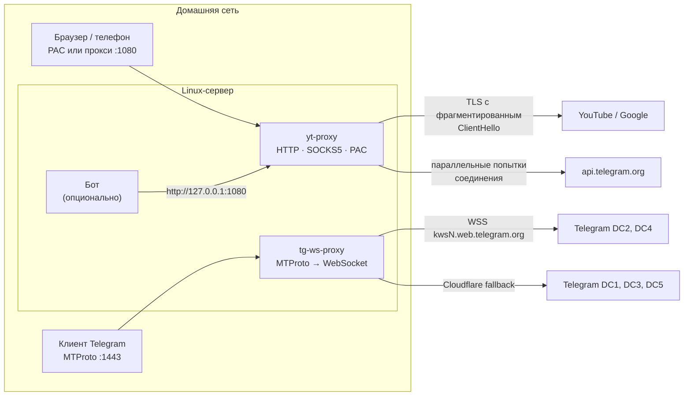

# linux-tg-yt-proxy

Доступ к YouTube и Telegram для всех устройств домашней сети через один Linux-сервер. **Без VPN и без внешних серверов**: трафик идёт напрямую к YouTube и Telegram, а сервер лишь изменяет форму пакетов так, чтобы система DPI провайдера не смогла их классифицировать.

Установка выполняется одной командой. Установщик сам подбирает метод обхода под конкретного провайдера, выбирает доступные адреса серверов Telegram, разворачивает службы systemd и в конце проверяет весь стек от начала до конца.

---

## Содержание

- [Возможности](#возможности)
- [Архитектура](#архитектура)
- [Требования](#требования)
- [Установка](#установка)
- [Автоматический подбор конфигурации](#автоматический-подбор-конфигурации)
- [Итоговая проверка](#итоговая-проверка)
- [Подключение клиентов](#подключение-клиентов)
- [Принцип работы](#принцип-работы)
- [Конфигурация](#конфигурация)
- [Файлы и службы](#файлы-и-службы)
- [Эксплуатация и диагностика](#эксплуатация-и-диагностика)
- [Удаление](#удаление)
- [Безопасность](#безопасность)
- [Ограничения](#ограничения)
- [Результаты тестирования](#результаты-тестирования)
- [Сторонние компоненты](#сторонние-компоненты)

---

## Возможности

- **YouTube для всей сети.** Прокси-сервер на одном порту понимает HTTP CONNECT, обычный HTTP-прокси и SOCKS5, а также отдаёт PAC-файл. По PAC на прокси направляются только домены YouTube, остальной трафик идёт напрямую.
- **Обход DPI на уровне TLS и TCP.** TLS ClientHello режется на несколько TLS-записей, разрыв проходит внутри имени сервера (SNI). Каждая запись уходит отдельным TCP-сегментом. Первый сегмент при необходимости отправляется с `TTL=1` (метод `disorder`), поэтому DPI видит рукопожатие не по порядку.
- **Устойчивость к выборочным потерям соединений.** Если провайдер молча отбрасывает часть новых TCP-соединений, прокси каждые 0,5 с открывает новую попытку с другого порта и использует первую удавшуюся, по аналогии с Happy Eyeballs (RFC 8305).
- **Telegram через MTProto-прокси.** [Flowseal/tg-ws-proxy](https://github.com/Flowseal/tg-ws-proxy) переносит MTProto в WebSocket over TLS к `kwsN.web.telegram.org`. Дата-центры, заблокированные по IP, обслуживаются через домены за Cloudflare.
- **Telegram Bot API.** Если IP `api.telegram.org` из DNS заблокирован, рабочий адрес закрепляется в `/etc/hosts` с учётом cloud-init. Боты на сервере работают через локальный прокси с повторными попытками соединения.
- **Автоподбор под провайдера.** Каждый параметр выбирается по измерениям, а не по заранее заданным значениям.
- **Проверка после установки.** Установщик проверяет YouTube через прокси, Bot API и настоящее MTProto-рукопожатие (`req_pq_multi` → `resPQ`) с каждым из пяти дата-центров Telegram.
- **Идемпотентность.** Повторный запуск заново подбирает параметры, сохраняя порты и секрет Telegram, поэтому клиентов перенастраивать не нужно.
- **Минимальные зависимости.** Прокси YouTube написан только на стандартной библиотеке Python. tg-ws-proxy ставится в изолированный venv и закреплён на проверенном коммите.

## Архитектура



| Компонент | Служба | Порт | Назначение |
|---|---|---|---|
| `yt-proxy.py` | `yt-proxy` | `1080/tcp` | HTTP/SOCKS5-прокси с обходом DPI, PAC-файл, выход к Bot API для ботов |
| Flowseal/tg-ws-proxy | `tg-ws-proxy` | `1443/tcp` | MTProto-прокси (секрет `dd`), транспорт WebSocket over TLS, резерв через Cloudflare |
| `install.sh` | — | — | Установка, автоподбор, генерация конфигурации и unit-файлов, итоговая проверка |
| `tg-check.py` | — | — | Проверка MTProto-прокси рукопожатием с каждым DC |

## Требования

| Параметр | Значение |
|---|---|
| ОС | Debian 12/13, Ubuntu 22.04+ (нужны `apt` и `systemd`). **Проверено на Debian 12 (bookworm), Python 3.11** |
| Архитектура | x86_64. На aarch64 должно работать (для `cryptography` есть колёса), но не проверялось |
| Ресурсы | 1 vCPU, 512 МБ ОЗУ. На тестовой ВМ система и обе службы занимали около 300 МБ |
| Диск | ~200 МБ (venv и исходники tg-ws-proxy) |
| Права | root |
| Сеть | Сервер в локальной сети за роутером, IPv4. Метод `disorder` рассчитан на то, что первый узел (роутер) находится до DPI провайдера |
| Доступ при установке | `deb.debian.org` / зеркала Ubuntu, `pypi.org` и `files.pythonhosted.org`, `api.github.com`, `codeload.github.com`, `raw.githubusercontent.com` |

Рекомендуется статический IP сервера или резервирование DHCP на роутере: адрес сервера прописывается на клиентах.

## Установка

### Публичный репозиторий

```bash
curl -fsSL https://raw.githubusercontent.com/Aut0iq/linux-tg-yt-proxy/main/install.sh | sudo bash
```

### Закрытый репозиторий

Нужен токен GitHub с доступом на чтение репозитория (`gh auth token` или fine-grained Personal Access Token с правом `Contents: Read`). Токен нужен дважды: для скачивания `install.sh` и для скачивания остальных файлов самим установщиком.

```bash
T=ваш_токен; curl -fsSL -H "Authorization: Bearer $T" https://raw.githubusercontent.com/Aut0iq/linux-tg-yt-proxy/main/install.sh | sudo GH_TOKEN=$T bash
```

### Из локального клона

```bash
git clone https://github.com/Aut0iq/linux-tg-yt-proxy
sudo bash linux-tg-yt-proxy/install.sh
```

Запущенный через конвейер (`curl | bash`), установщик не находит рядом с собой остальных файлов. Тогда он скачивает архив репозитория через `api.github.com/repos/Aut0iq/linux-tg-yt-proxy/tarball/<REF>` (по умолчанию `REF=main`) и запускает уже полную копию.

### Ход установки

Установка занимает **3,5–5 минут**, в основном на измерения:

1. Установка пакетов: `python3`, `python3-venv`, `curl`, `ca-certificates`, `iproute2`, `openssl`.
2. Чтение `/etc/linux-tg-yt-proxy.conf`, если он остался от прошлой установки. Порты и секрет сохраняются; новый секрет создаётся через `openssl rand -hex 16`.
3. Остановка служб, если они уже запущены, чтобы их собственный трафик не искажал измерения.
4. Копирование `yt-proxy.py` и `tg-check.py` в `/opt/linux-tg-yt-proxy`. Загрузка tg-ws-proxy на закреплённом коммите и установка его зависимостей в venv: `cryptography==46.0.5`, `certifi`, `httpx[http2]==0.28.1`.
5. [Автоматический подбор конфигурации](#автоматический-подбор-конфигурации).
6. Запись конфигурации и unit-файлов, включение и запуск служб.
7. [Итоговая проверка](#итоговая-проверка) и вывод параметров подключения.

## Автоматический подбор конфигурации

Все измерения выполняются функцией `score N URL`: `N` последовательных запросов `curl` с `--connect-timeout 4` и `--max-time 7`. Успехом считается любой HTTP-ответ (код ≠ `000`), так как важна доступность узла, а не содержимое ответа.

### 1. Метод обхода для YouTube

На `127.0.0.1:18080` поднимается временный экземпляр `yt-proxy` с каждым методом по очереди. Через него выполняется 12 запросов: по 4 к `https://www.youtube.com/`, `https://i.ytimg.com/generate_204` и `https://redirector.googlevideo.com/generate_204`. Последние два узла — это CDN изображений и узел распределения видеопотоков.

| Порядок | Метод | Что делает |
|---|---|---|
| 1 | `none` | Прозрачная ретрансляция без изменений |
| 2 | `split` | Фрагментация ClientHello на TLS-записи и TCP-сегменты |
| 3 | `disorder` | `split` + первый сегмент с `TTL=1` |

Выбирается метод с наибольшим числом успехов. При равенстве побеждает более простой (раньше в списке). Перебор прекращается, как только какой-то метод даёт 12/12: если провайдер ничего не блокирует, останется `none` без лишней задержки. Если не сработал ни один метод, сохраняется `disorder` и выводится предупреждение.

### 2. Адреса дата-центров Telegram

Для каждого DC1–DC5 кандидатами служат A-записи `kwsN.web.telegram.org` и адрес `149.154.167.220`. Каждый кандидат проверяется пятью запросами к `https://kwsN.web.telegram.org/apiws` с подменой адреса через `--resolve`. Лучший кандидат с результатом не ниже 3/5 передаётся в tg-ws-proxy как `--dc-ip N:IP`. Если подходящего адреса нет, DC не прописывается, и tg-ws-proxy обслуживает его через Cloudflare.

### 3. Адрес Telegram Bot API

Сначала из `/etc/hosts` и шаблонов cloud-init удаляются строки, добавленные прошлой установкой (маркер `# linux-tg-yt-proxy`). Затем каждый кандидат (A-записи `api.telegram.org` и `149.154.167.220`) проверяется шестью запросами. Если лучший адрес не входит в ответ DNS, он закрепляется в `/etc/hosts` и в `/etc/cloud/templates/hosts.*.tmpl`: при `manage_etc_hosts: true` cloud-init пересоздаёт `/etc/hosts` из шаблона при каждой загрузке.

## Итоговая проверка

После запуска служб установщик проверяет систему так же, как её будут использовать клиенты:

| Проверка | Метод | OK / WARN / FAIL |
|---|---|---|
| YouTube | 12 запросов через `http://<IP сервера>:1080` | 12/12 / частично / 0 |
| Bot API | 10 запросов к `api.telegram.org` через `http://127.0.0.1:1080` | 10/10 / частично / 0 |
| Telegram | `tg-check.py`: `req_pq_multi` к DC1–DC5 через MTProto-прокси, до 3 попыток на DC | все DC / — / хотя бы один DC не ответил |
| Службы | `systemctl is-active yt-proxy tg-ws-proxy` | активны / — / не активны |

При любом результате FAIL установщик завершается с кодом 1. В конце он выводит ссылку `tg://proxy`, адрес PAC-файла и параметры ручной настройки.

## Подключение клиентов

IP сервера определяется автоматически (`ip -4 route get 1.1.1.1`) и выводится в конце установки.

### Telegram

Откройте на устройстве ссылку вида:

```
tg://proxy?server=<IP>&port=1443&secret=dd<32 hex>
```

Ручная настройка: Настройки → Данные и память → Прокси → Добавить прокси → **MTProto**, сервер `<IP>`, порт `1443`, секрет `dd…` из ссылки. Префикс `dd` включает режим padded intermediate.

### YouTube: автонастройка (рекомендуется)

URL PAC-файла: `http://<IP>:1080/proxy.pac`. На прокси направляются `youtube.com`, `youtu.be`, `googlevideo.com`, `ytimg.com`, `ggpht.com`, `youtube-nocookie.com`, `googleapis.com` и их поддомены. Для них возвращается `PROXY <IP>:1080; DIRECT`: если сервер недоступен, браузер пойдёт напрямую.

| Платформа | Где настроить |
|---|---|
| Windows 10/11 | Параметры → Сеть и Интернет → Прокси → Использовать сценарий настройки |
| macOS | Системные настройки → Сеть → Подробнее → Прокси → Автоконфигурация прокси |
| Android | Wi-Fi → сеть → Изменить → Прокси → Автоконфигурация |
| iOS / iPadOS | Wi-Fi → (i) → Настройка прокси → Авто → URL |
| Linux (GNOME) | Параметры → Сеть → Сетевой прокси → Автоматически |

### YouTube: ручная настройка

HTTP-прокси или SOCKS5 `<IP>:1080`. В этом режиме через сервер идёт весь трафик устройства. Это работает, но к каждому новому TLS-соединению добавляется задержка метода `disorder`.

### Боты на сервере

Используйте long polling и HTTP-прокси `http://127.0.0.1:1080`. Webhook требует входящих соединений на внешний адрес и в этой схеме не поддерживается.

```python
# aiogram 3 (нужен пакет aiohttp-socks)
from aiogram import Bot
from aiogram.client.session.aiohttp import AiohttpSession
bot = Bot(TOKEN, session=AiohttpSession(proxy="http://127.0.0.1:1080"))

# python-telegram-bot 20.7+ (в более ранних версиях proxy_url / get_updates_proxy_url)
from telegram.ext import Application
app = (Application.builder().token(TOKEN)
       .proxy("http://127.0.0.1:1080").get_updates_proxy("http://127.0.0.1:1080").build())

# requests
requests.get(f"https://api.telegram.org/bot{TOKEN}/getMe", proxies={"https": "http://127.0.0.1:1080"})
```

Без прокси бот тоже работает, но часть новых соединений к Telegram провайдер отбрасывает, и ответы бота периодически задерживаются на время повторных попыток библиотеки.

## Принцип работы

### Как блокирует провайдер

Ниже — поведение, наблюдавшееся на тестовом стенде (домашний провайдер, РФ, октябрь 2026). У другого провайдера картина может отличаться, поэтому установщик и проводит измерения.

- **YouTube:** TCP-рукопожатие проходит, а пакет TLS ClientHello с SNI из списка (`youtube.com`, `googlevideo.com`, `ytimg.com`) примерно в половине случаев молча отбрасывается. Клиент повторяет его до истечения таймаута, сервер закрывает соединение по простою. Блокировка вероятностная, поэтому сайт то открывается, то нет.
- **Сборка фрагментов.** Судя по замерам, DPI собирает простую фрагментацию TLS-записей и TCP-сегментов: метод `split` не даёт улучшения относительно прямого подключения.
- **Telegram:** работает блокировка по IP. Проверенные адреса `149.154.175.50`, `91.108.56.130`, `149.154.174.100` (`kws1`), `149.154.167.99` (`kws2`/`kws4`) и `149.154.166.110` (A-запись `api.telegram.org`) почти полностью недоступны. `149.154.167.220` доступен, но около трети новых соединений к нему тоже отбрасывается.

### Фрагментация ClientHello (`split`)

Прокси дочитывает от клиента первую TLS-запись целиком (`5 + length` байт), находит в ней расширение `server_name` разбором структуры ClientHello (session id, cipher suites, compression, extensions) и делит тело записи в двух местах:

```
исходная запись: [16 03 01 LEN][01 | 00 01 FC 03 03 … SNI "www.youtube.com" …]
после разбиения: [16 03 01 0001][01]
                 [16 03 01 xxxx][00 01 FC 03 03 … "www]
                 [16 03 01 yyyy][.youtube.com" …]
```

- Первая запись содержит только тип handshake-сообщения, поэтому сигнатура `ClientHello` не видна в первом пакете.
- Второй разрыв проходит на 3 байта внутри имени хоста, так что полного SNI нет ни в одной записи.
- Каждая запись получает собственный заголовок (тот же content type и версия, новая длина) и отправляется отдельным вызовом `send` с `TCP_NODELAY`, то есть отдельным TCP-сегментом.

Стандарт TLS (RFC 8446, §5.1) разрешает дробить handshake-сообщение на несколько записей, поэтому сервер собирает ClientHello штатно. Сам TLS прокси не расшифровывает и не терминирует.

### Обмен порядком сегментов (`disorder`)

Первый сегмент (6 байт) отправляется с `IP_TTL=1` (`IPV6_UNICAST_HOPS=1` для IPv6). Он истекает на первом маршрутизаторе, то есть домашнем роутере, и до провайдера не доходит. Через 10 мс TTL восстанавливается, и уходят остальные сегменты. Сервер получает их с «дыркой» и подтверждает через SACK; ядро повторно отправляет первый сегмент уже с обычным TTL (RACK-TLP или RTO). В итоге DPI видит начало рукопожатия последним и не может сопоставить поток с ClientHello. Цена — примерно один RTT дополнительной задержки на каждое новое TLS-соединение через прокси.

### Параллельные попытки соединения

Исходящее соединение строится так:

- адреса из `getaddrinfo`, IPv4 в приоритете, используются до трёх адресов по кругу;
- до 6 попыток, новая стартует каждые 0,5 с с новым исходным портом, общий таймаут 8 с;
- побеждает первое установленное соединение, остальные закрываются, в том числе успевшие установиться после отмены;
- явный отказ (`ECONNREFUSED`) не вызывает ожидания, ошибка возвращается сразу.

Если сервер отвечает быстрее 0,5 с, вторая попытка не создаётся и накладных расходов нет. Против выборочного отбрасывания соединений это повышает долю успешных подключений к Bot API примерно с 60 % до 100 % (см. [результаты](#результаты-тестирования)).

### Прочее поведение прокси

- Тип протокола определяется по первому байту: `0x05` — SOCKS5, иначе HTTP.
- SOCKS5: без аутентификации, команда `CONNECT`, адреса IPv4, доменное имя, IPv6. Остальные команды получают ответ `0x07` (command not supported).
- HTTP: запрос с путём `/…` получает PAC-файл, `CONNECT host:port` открывает туннель, запрос с абсолютным URI пересылается на `host:port` из URI (по умолчанию 80) с удалением `Connection`, `Proxy-Connection`, `Keep-Alive` и добавлением `Connection: close`. Так одно соединение не переиспользуется для разных хостов.
- Если клиент 3 с ничего не отправляет (протоколы, где первым говорит сервер: SSH, SMTP), туннель работает как обычная ретрансляция.
- При запуске выполняются самотесты: разбор и разбиение синтетического ClientHello без потери байтов, отсутствие SNI в результате, устойчивость к обрезанному ClientHello, проверка значения `YT_STRATEGY`, установка соединения с локальным портом и быстрый отказ на закрытом порту.

### Telegram: tg-ws-proxy

tg-ws-proxy принимает от клиента обфусцированный MTProto (obfuscated2, секрет `dd`) и определяет номер DC из init-пакета. Затем он передаёт трафик по WebSocket over TLS на `kwsN.web.telegram.org` (точку входа Telegram Web) по адресу из `--dc-ip`. Для снижения задержек держится пул заранее установленных WebSocket-соединений (по умолчанию 4 на DC, ротация каждые 120 с). Если WebSocket недоступен, используется резерв через домены за Cloudflare: их список загружается с GitHub, в коде есть встроенный запасной. Медиа через Cloudflare передаётся по HTTP/2.

### Проверка `tg-check.py`

Скрипт открывает TCP-соединение с прокси так же, как настоящий клиент:

- формирует 64-байтный init obfuscated2 со случайными данными, исключая запрещённые префиксы (`0xef`, `HEAD`, `POST`, `GET `, `OPTI`, `0xdddddddd`, `0xeeeeeeee`, TLS);
- записывает тег протокола `0xdddddddd` и номер DC;
- выводит ключи AES-256-CTR как `SHA-256(init[8:40] ‖ secret)` и обратный порядок для приёма;
- отправляет незашифрованное сообщение `req_pq_multi` (`0xbe7e8ef1`) со случайным nonce.

Проверка успешна, только если пришёл `resPQ` (`0x05162463`) с тем же nonce, то есть ответ действительно сформирован сервером Telegram выбранного DC. С неверным секретом проверка не проходит.

## Конфигурация

### `/etc/linux-tg-yt-proxy.conf`

Создаётся установщиком с правами `0600` и читается обеими службами через `EnvironmentFile`.

| Переменная | Пример | Описание |
|---|---|---|
| `YT_PORT` | `1080` | Порт прокси YouTube (HTTP, SOCKS5, PAC) |
| `YT_STRATEGY` | `disorder` | `none`, `split` или `disorder`, выбирается автоматически |
| `TG_PORT` | `1443` | Порт MTProto-прокси |
| `TG_SECRET` | `4bb8…7a92` | 32 hex-символа, в ссылке передаётся с префиксом `dd` |
| `TG_ARGS` | `--dc-ip 2:149.154.167.220 --dc-ip 4:149.154.167.220` | Дополнительные аргументы tg-ws-proxy, подбираются автоматически |

Чтобы сменить значения вручную, отредактируйте файл и выполните `systemctl restart yt-proxy tg-ws-proxy`. Повторный запуск установщика сохранит порты и секрет, но заново подберёт `YT_STRATEGY` и `TG_ARGS`.

### Переменные окружения установщика

| Переменная | По умолчанию | Описание |
|---|---|---|
| `YT_PORT`, `TG_PORT` | `1080`, `1443` | Порты при первой установке |
| `TG_SECRET` | случайный | Секрет при первой установке, например при переносе со старого сервера |
| `TG_WS_PROXY_REF` | `307a384…` | Коммит Flowseal/tg-ws-proxy |
| `GH_TOKEN` | — | Токен для скачивания из закрытого репозитория |
| `REF` | `main` | Ветка или тег этого репозитория при запуске через `curl \| bash` |

Если конфигурационный файл уже существует, значения из него имеют приоритет над переменными окружения.

## Файлы и службы

```
/opt/linux-tg-yt-proxy/
├── yt-proxy.py          прокси YouTube
├── tg-check.py          проверка MTProto
├── tg-ws-proxy/         исходники Flowseal/tg-ws-proxy на закреплённом коммите
└── venv/                Python-окружение tg-ws-proxy
/etc/linux-tg-yt-proxy.conf
/etc/systemd/system/yt-proxy.service
/etc/systemd/system/tg-ws-proxy.service
/etc/hosts                       (+ строка api.telegram.org, если нужна)
/etc/cloud/templates/hosts.*.tmpl (та же строка для cloud-init)
```

Обе службы запускаются с `DynamicUser=yes` (временный непривилегированный пользователь), `Restart=always`, `RestartSec=3`, после `network-online.target` и включены в автозапуск.

## Эксплуатация и диагностика

```bash
systemctl status yt-proxy tg-ws-proxy                 # состояние служб
journalctl -u yt-proxy -u tg-ws-proxy -b              # журналы с момента загрузки
journalctl -u tg-ws-proxy -f                          # журнал Telegram-прокси в реальном времени
sudo bash install.sh                                  # повторный подбор после смены провайдера или симптомов

# ручные проверки
curl -s http://127.0.0.1:1080/proxy.pac
curl -so /dev/null -w '%{http_code}\n' -x http://127.0.0.1:1080 https://www.youtube.com/
curl -so /dev/null -w '%{http_code}\n' -x http://127.0.0.1:1080 https://api.telegram.org/
. /etc/linux-tg-yt-proxy.conf
/opt/linux-tg-yt-proxy/venv/bin/python /opt/linux-tg-yt-proxy/tg-check.py 127.0.0.1 "$TG_PORT" "$TG_SECRET"
```

| Симптом | Вероятная причина | Действие |
|---|---|---|
| YouTube снова открывается через раз | Провайдер изменил метод блокировки | Запустить установщик повторно |
| Бот перестал подключаться | Устарел закреплённый IP `api.telegram.org` | Запустить установщик повторно (старая строка удаляется автоматически) |
| Клиент Telegram не подключается | Неверный секрет или порт закрыт межсетевым экраном | Сверить ссылку с конфигом; открыть `1443/tcp` в LAN |
| PAC не применяется | Устройство кэширует PAC или не поддерживает автонастройку | Переподключить Wi-Fi; использовать ручной прокси |
| Установщик завершился с FAIL | Сервис не стартовал или узел недоступен | Посмотреть вывод проверки и `journalctl` |

## Удаление

```bash
sudo systemctl disable --now yt-proxy tg-ws-proxy
sudo rm -rf /opt/linux-tg-yt-proxy /etc/linux-tg-yt-proxy.conf /etc/systemd/system/{yt-proxy,tg-ws-proxy}.service
sudo sed -i '/# linux-tg-yt-proxy$/d' /etc/hosts /etc/cloud/templates/hosts.*.tmpl 2>/dev/null
sudo systemctl daemon-reload
```

## Безопасность

- **yt-proxy** принимает соединения только с частных и служебных адресов (RFC 1918, loopback, link-local и другие диапазоны, для которых `ipaddress.is_private` истинно). Подключения с публичных адресов закрываются сразу, так что открытым прокси сервер стать не может. Аутентификации нет: доверенной считается локальная сеть.
- **tg-ws-proxy** слушает `0.0.0.0:1443`, доступ защищён 128-битным секретом.
- **Не пробрасывайте** порты `1080` и `1443` на роутере в интернет.
- TLS не расшифровывается и не терминируется: прокси работает только с заголовками записей и не имеет доступа к содержимому.
- Службы работают под `DynamicUser` без привилегий. Конфигурационный файл с секретом доступен только root (`0600`); systemd читает его до сброса привилегий.
- Сторонний код (tg-ws-proxy) загружается по фиксированному коммиту, Python-зависимости закреплены версиями.

## Ограничения

- **Только TCP.** QUIC/HTTP3 не проксируется; браузеры при работе через прокси используют TCP автоматически.
- **Нужна настройка устройств** (PAC или прокси). Прозрачного режима для всей сети нет. Приложения, игнорирующие системный прокси (часть Smart TV и ТВ-приставок), не охватываются.
- **Метод `disorder`** добавляет около одного RTT к установке каждого нового соединения через прокси. Он рассчитан на то, что первый узел (роутер) расположен до DPI. На сервере с публичным адресом напрямую у провайдера эффективность не гарантируется.
- **Исходящий IPv6** не используется, если доступен IPv4.
- **Webhook** для ботов не поддерживается, только long polling.
- **Параметры привязаны к моменту измерения.** При изменении методов блокировки или адресов Telegram нужно запустить установщик повторно.
- **Проверено** только на Debian 12 x86_64 у одного провайдера.

## Результаты тестирования

Стенд: виртуальная машина Proxmox (1 vCPU, 1 ГБ ОЗУ, Debian 12 genericcloud), домашняя сеть, провайдер с DPI (РФ), 28.10.2026.

**Подбор метода для YouTube** (успешных запросов из 12). Установка 1 — чистая ВМ; 2 — повторный запуск на той же ВМ (проверка идемпотентности, секрет сохранён); 3 — перевод рабочей ВМ с ручной установки на установщик с переносом прежнего секрета:

| Метод | Установка 1 | Установка 2 | Установка 3 |
|---|---|---|---|
| `none` (без обхода) | 5 | 6 | 7 |
| `split` | 7 | 5 | 6 |
| `disorder` | **12** | **12** | **12** |

**Нагрузочная проверка с клиента в LAN** через прокси сервера:

| Узел | Результат |
|---|---|
| `www.youtube.com/watch?v=…` | 30/30 |
| `i.ytimg.com` (изображение превью) | 30/30 |
| `redirector.googlevideo.com` | 30/30 |
| `api.telegram.org` | 30/30 |

Скорость загрузки `base.js` плеера YouTube (3 МБ) через прокси на сервере — около 1,7 МБ/с в одном соединении.

**Telegram:**

| Проверка | Результат |
|---|---|
| MTProto `req_pq_multi` через прокси, DC1–DC5 | 5/5 DC, 0,2–1,0 с |
| Тот же тест с неверным секретом | отказ (контроль) |
| Bot API напрямую через закреплённый IP | 6/10 – 17/20 |
| Bot API через `yt-proxy` (параллельные попытки) | 10/10, 30/30 |
| `149.154.166.110` (A-запись `api.telegram.org`) | 0–2 из 6 |

**Время установки:** 3 мин 49 с – 4 мин 47 с. После перезагрузки обе службы поднимаются автоматически, закреплённая запись в `/etc/hosts` сохраняется.

## Сторонние компоненты

- [Flowseal/tg-ws-proxy](https://github.com/Flowseal/tg-ws-proxy): MTProto-прокси через WebSocket. Загружается при установке и распространяется на условиях собственной лицензии.
- Идеи методов фрагментации и обмена порядком сегментов заимствованы из открытых проектов обхода DPI: byedpi, zapret, GoodbyeDPI. Реализация в `yt-proxy.py` написана заново и использует только стандартную библиотеку Python.
